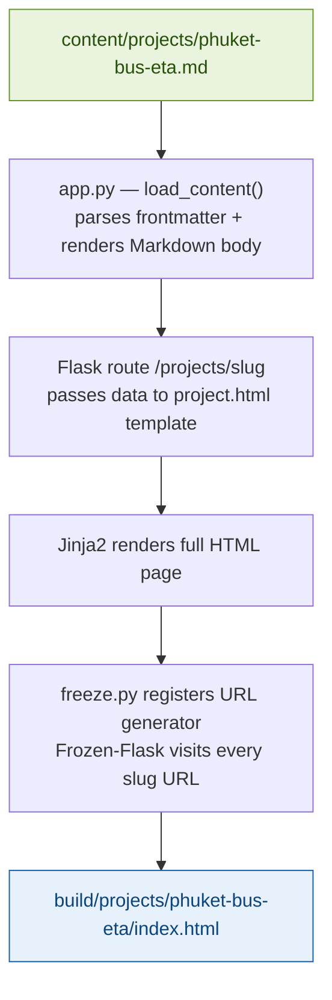
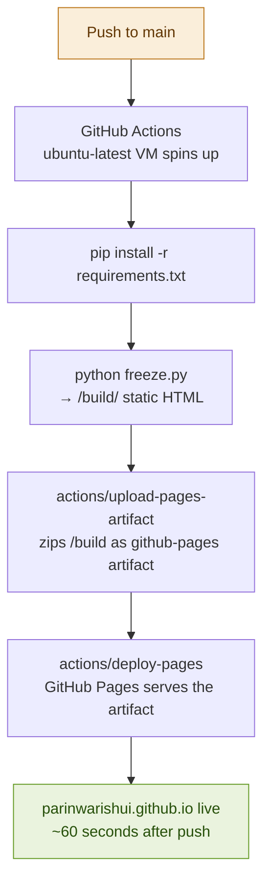

# parinwarishui.github.io

Personal portfolio and blog — built with Flask and Frozen-Flask, deployed to GitHub Pages via GitHub Actions.

**View Live site at:** [parinwarishui.github.io](https://parinwarishui.github.io)


---

## Architecture

```
parinwarishui.github.io/
│
├── app.py                  # Flask app — routes, content loader, Markdown renderer
├── freeze.py               # Frozen-Flask config — generates static /build output
├── requirements.txt
│
├── content/
│   ├── posts/              # Blog posts — one .md file per post
│   │   └── example-post.md
│   └── projects/           # Project writeups — one .md file per project
│       └── phuket-bus-eta.md
│
├── templates/              # Jinja2 HTML templates
│   ├── base.html
│   ├── index.html
│   ├── post.html
│   └── project.html
│
├── static/
│   ├── css/
│   └── img/               # Images referenced by Markdown files
│
├── build/                  # Generated static site — gitignored, created by freeze.py
│
└── .github/
    └── workflows/
        └── deploy.yml      # GitHub Actions — builds and deploys on push to main
```

---

## Tech stack

| Tool            | Purpose                                     |
| --------------- | ------------------------------------------- |
| Flask           | Web framework — routing and templating      |
| Frozen-Flask    | Crawls Flask routes and outputs static HTML |
| Jinja2          | HTML templating (comes with Flask)          |
| Python-Markdown | Renders Markdown body to HTML               |
| PyYAML          | Parses YAML frontmatter                     |
| GitHub Actions  | CI/CD — builds and deploys on every push    |
| GitHub Pages    | Static site hosting                         |

---

## How content works

This site mimics the Jekyll blog post pattern using plain Markdown files with YAML frontmatter. While GitHub Pages natively supports Jekyll, this site uses Flask instead, to give full Python control over templating, content loading, and URL generation, then freezes it to static HTML using Frozen-Flask before deployment. The result behaves identically to a Jekyll site (with Markdown files to rendered HTML pages) without being locked into Ruby or Jekyll's conventions.

### Writing a post or project

Create a `.md` file in `content/posts/` or `content/projects/`:

```markdown
---
title: "My Post Title"
date: "2026-07-04"
tags: [python, data]
summary: "A short description shown on the listing page."
image: "/static/img/my_image.png"
---

## Overview

Write your content here in standard Markdown.
```

The `load_content()` function in `app.py` reads every `.md` file in the directory, parses the YAML frontmatter, renders the body to HTML, and returns a list of content objects. Flask routes then pass these to Jinja2 templates.

### Markdown -> HTML (Steps)



The slug is derived from the filename, e.g. `phuket-bus-eta.md` becomes `/projects/phuket-bus-eta/`.

### Register new content types

If you add a new content section (e.g. `content/notes/`), register a URL generator in `freeze.py`:

```python
@freezer.register_generator
def note():
    for n in load_content(NOTES_DIR):
        yield {'slug': n['slug']}
```

Without this, Frozen-Flask won't know to visit those URLs and the pages won't be generated.

---

## Local development

```bash
# Install dependencies
pip install -r requirements.txt

# Run Flask dev server (live reload, no freezing needed)
python app.py

# Build static site locally to /build
python freeze.py
```

The dev server runs at `http://localhost:5000`. You don't need to freeze locally unless you want to test the exact static output.

---

## Deployment

Every push to `main` triggers a GitHub Actions workflow that:

1. Checks out the repo
2. Installs Python dependencies
3. Runs `freeze.py` to generate `/build`
4. Uploads `/build` as a GitHub Pages artifact
5. Deploys the artifact to GitHub Pages



### Workflow file

```yaml
# .github/workflows/deploy.yml
name: Deploy to GitHub Pages

on:
  push:
    branches: [main]

permissions:
  contents: read
  pages: write
  id-token: write

concurrency:
  group: "pages"
  cancel-in-progress: true

jobs:
  deploy:
    environment:
      name: github-pages
      url: ${{ steps.deployment.outputs.page_url }}
    runs-on: ubuntu-latest
    steps:
      - uses: actions/checkout@v4
      - uses: actions/setup-python@v5
        with:
          python-version: "3.10"
      - run: pip install -r requirements.txt
      - run: python freeze.py
      - uses: actions/upload-pages-artifact@v3
        with:
          path: build/
      - id: deployment
        uses: actions/deploy-pages@v4
```

### Required GitHub settings

In **Settings → Pages → Build and deployment**, source must be set to **GitHub Actions** (not "Deploy from a branch"). Without this, the deploy step will fail with "Deployment failed, try again later."

---

## Adding a new project writeup

1. Create `content/projects/your-project-name.md` with frontmatter
2. Add any images to `static/img/`
3. Push to `main` — the site rebuilds and deploys automatically

No config changes needed. The content loader picks up new files automatically. This also applies for `blog` posts.

---
