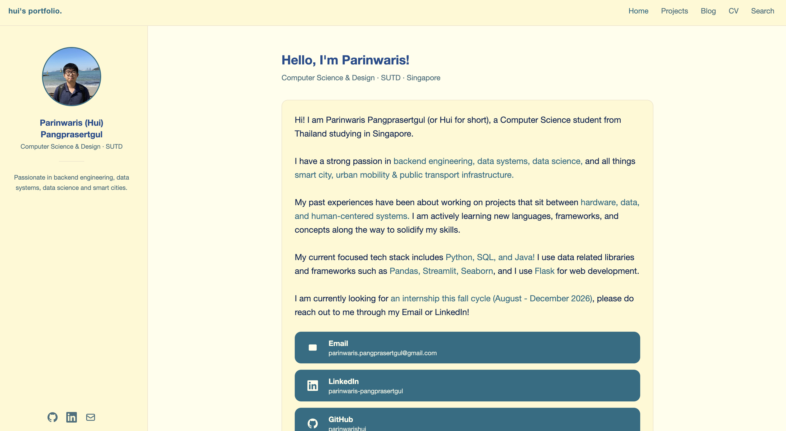
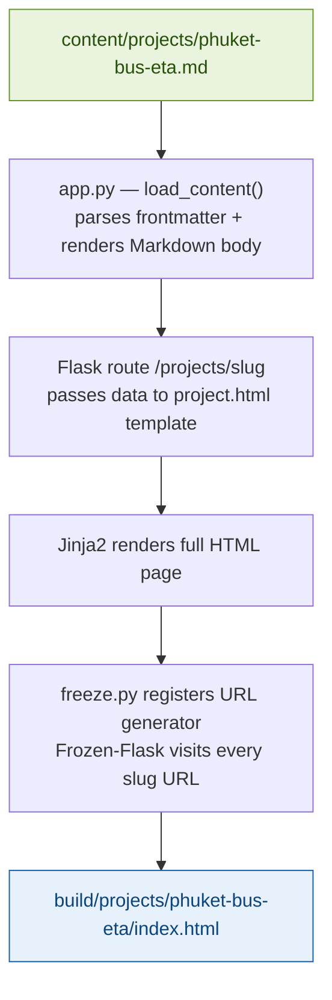
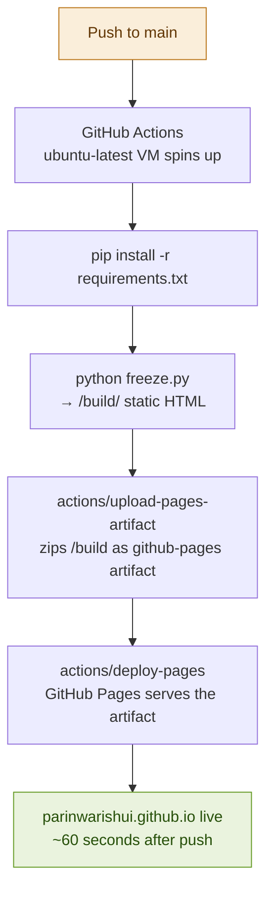

# parinwarishui.github.io

Personal portfolio and blog — built with Flask and Frozen-Flask, deployed to GitHub Pages via GitHub Actions.

**View Live site at:** [parinwarishui.github.io](https://parinwarishui.github.io)



---

## Architecture

```
parinwarishui.github.io/
│
├── app.py                  # Flask app — SITE config, routes, content loader, Markdown renderer
├── freeze.py               # Frozen-Flask config — generates static /build output
├── requirements.txt
│
├── content/
│   ├── posts/              # Published blog posts — one .md file per post
│   ├── projects/           # Published project writeups — one .md file per project
│   ├── drafts/             # Work-in-progress posts — NOT loaded or published
│   └── _templates/         # Copy-paste starters: post_template.md, project_template.md
│
├── templates/              # Jinja2 HTML templates (all extend base.html)
│   ├── base.html           # Shell: <head>, Tailwind theme, nav bar, profile sidebar
│   ├── home.html           # /             — intro, contact cards, latest 5 projects + posts
│   ├── projects.html       # /projects/    — list of all projects
│   ├── project.html        # /projects/<slug>/ — single project page
│   ├── blog.html           # /blog/        — list of all posts
│   ├── post.html           # /blog/<slug>/ — single post page
│   ├── cv.html             # /cv/          — hand-written CV (static HTML, no Markdown)
│   └── search.html         # /search/      — client-side search + tag filter
│
├── static/
│   └── img/                # Images referenced by Markdown files and templates
│       └── icons/          # Contact icons (email, GitHub, LinkedIn)
│
├── build/                  # Generated static site — gitignored, created by freeze.py
│
└── .github/
    └── workflows/
        └── deploy.yml      # GitHub Actions — builds and deploys on push to main
```

There is no separate CSS file: styling uses Tailwind via the Play CDN (`cdn.tailwindcss.com`), configured inline in `base.html`. Colours are CSS variables in the `:root` block of `base.html` ("central color control hub"), mapped to Tailwind names like `bg-box`, `text-accent` and `text-heading`. Code blocks are highlighted in the browser by highlight.js (also from a CDN).

Site-wide details (name, bio, email, social links, profile photo) live in the `SITE` dict at the top of `app.py` and are passed to every template.

---

## Tech stack

| Tool               | Purpose                                     |
| ------------------ | ------------------------------------------- |
| Flask              | Web framework — routing and templating      |
| Frozen-Flask       | Crawls Flask routes and outputs static HTML |
| Jinja2             | HTML templating (comes with Flask)          |
| Python-Markdown    | Renders Markdown body to HTML               |
| python-frontmatter | Splits and parses the YAML frontmatter      |
| Tailwind CSS (CDN) | Styling, configured inline in `base.html`   |
| highlight.js (CDN) | Syntax highlighting for code blocks         |
| GitHub Actions     | CI/CD — builds and deploys on every push    |
| GitHub Pages       | Static site hosting                         |

---

## Pages

Every page extends `base.html`, which provides the fixed top nav (Home, Projects, Blog, CV, Search) and the profile sidebar. Each route passes a `page` value that highlights the active nav link. On mobile, the sidebar appears only on the home page.

| URL                 | Route in `app.py` | Template        | What it does                                                                                       |
| ------------------- | ----------------- | --------------- | -------------------------------------------------------------------------------------------------- |
| `/`                 | `home()`          | `home.html`     | Intro, contact cards, the 5 newest projects and 5 newest posts, and links to CV and Search         |
| `/projects/`        | `projects()`      | `projects.html` | Every file in `content/projects/`, newest first                                                    |
| `/projects/<slug>/` | `project(slug)`   | `project.html`  | One project: hero image, date, tags, rendered Markdown body                                        |
| `/blog/`            | `blog()`          | `blog.html`     | Every file in `content/posts/`, newest first                                                       |
| `/blog/<slug>/`     | `post(slug)`      | `post.html`     | One post, same layout as a project page                                                            |
| `/cv/`              | `cv()`            | `cv.html`       | Static CV. Edit the HTML in the template directly; it is not built from Markdown                  |
| `/search/`          | `search()`        | `search.html`   | Search and tag filter over all posts and projects, run entirely in the browser (see below)         |

The detail routes call `load_content()` and look for a matching slug, returning 404 if there is none. Content is re-read from disk on every request, so in the dev server new or edited Markdown files show up on refresh.

### How search works without a backend

GitHub Pages serves only static files, so search cannot query a server. Instead, at build time `search()` collects the title, summary, tags, date, URL and type of every post and project into a JSON list and writes it directly into the page (`const INDEX = {{ search_index | safe }}`). The JavaScript in `search.html` then:

1. builds a tag cloud from every tag in the index,
2. filters on each keystroke: the query must match the title, summary or a tag, and the item must have **all** selected tags,
3. renders the matches as cards linking to their pages.

The index is generated at freeze time, so search covers whatever was published at the last deploy.

---

## How content works

This site mimics the Jekyll blog post pattern using plain Markdown files with YAML frontmatter. While GitHub Pages natively supports Jekyll, this site uses Flask instead, to give full Python control over templating, content loading, and URL generation, then freezes it to static HTML using Frozen-Flask before deployment. The result behaves identically to a Jekyll site (with Markdown files to rendered HTML pages) without being locked into Ruby or Jekyll's conventions.

### Writing a post or project

Create a `.md` file in `content/posts/` or `content/projects/`:

```markdown
---
title: "My Post Title"
date: "2026-07-04"
tags: [python, data]
summary: "A short description shown on the listing page."
image: "/static/img/my_image.png"
---

## Overview

Write your content here in standard Markdown.
```

The easiest way to start is to copy `content/_templates/post_template.md` or `project_template.md`.

The `load_content()` function in `app.py` reads every `.md` file in the directory (skipping files that start with `_`), parses the YAML frontmatter, renders the body to HTML, and returns a list of content objects sorted newest-first by `date`. Flask routes then pass these to Jinja2 templates. Missing fields fall back to defaults (`title` becomes "Untitled", and `tags` becomes an empty list).

The Markdown renderer enables `fenced_code`, `tables`, `attr_list` and `nl2br`. With `nl2br`, a single line break in the source becomes a `<br>`, so you don't need a blank line to start a new line.

### Drafts

Files in `content/drafts/` are never loaded, so they are never published. When a draft is ready, move it to `content/posts/` (and remove any date prefix from the filename if you don't want it in the URL).

### Markdown -> HTML (Steps)



The slug is derived from the filename, e.g. `phuket-bus-eta.md` becomes `/projects/phuket-bus-eta/`.

### Register new content types

If you add a new content section (e.g. `content/notes/`), register a URL generator in `freeze.py`:

```python
@freezer.register_generator
def note():
    for n in load_content(NOTES_DIR):
        yield {'slug': n['slug']}
```

Without this, Frozen-Flask won't know to visit those URLs and the pages won't be generated. The generator's name must match the Flask endpoint (the view function name), as `post` and `project` do. Pages without parameters (`/`, `/projects/`, `/blog/`, `/cv/`, `/search/`) are found automatically, as are any links Frozen-Flask finds while crawling.

---

## Local development

```bash
# Install dependencies
pip install -r requirements.txt

# Run Flask dev server (live reload, no freezing needed)
python app.py

# Build static site locally to /build
python freeze.py
```

The dev server runs at `http://localhost:5000`. You don't need to freeze locally unless you want to test the exact static output.

---

## Deployment

Every push to `main` triggers a GitHub Actions workflow that:

1. Checks out the repo
2. Installs Python dependencies
3. Runs `freeze.py` to generate `/build`
4. Uploads `/build` as a GitHub Pages artifact
5. Deploys the artifact to GitHub Pages



### Workflow file

```yaml
# .github/workflows/deploy.yml
name: Deploy to GitHub Pages

on:
  push:
    branches: [main]

permissions:
  contents: read
  pages: write
  id-token: write

concurrency:
  group: "pages"
  cancel-in-progress: true

jobs:
  deploy:
    environment:
      name: github-pages
      url: ${{ steps.deployment.outputs.page_url }}
    runs-on: ubuntu-latest
    steps:
      - uses: actions/checkout@v4
      - uses: actions/setup-python@v5
        with:
          python-version: "3.10"
      - run: pip install -r requirements.txt
      - run: python freeze.py
      - uses: actions/upload-pages-artifact@v3
        with:
          path: build/
      - id: deployment
        uses: actions/deploy-pages@v4
```

### Workflow details

- **Trigger:** only pushes to `main`. Pull requests and other branches are not built, so there is no CI check before merging; run `python freeze.py` locally to catch build errors first.
- **Permissions:** `pages: write` and `id-token: write` let `deploy-pages` publish using GitHub's OIDC token. No secrets are needed.
- **Concurrency:** the `pages` group with `cancel-in-progress: true` means that if you push twice quickly, the older run is cancelled and only the newest commit deploys.
- **Environment:** the job runs in the `github-pages` environment, and the live URL appears on the run summary.
- **Build output:** CI always runs `freeze.py` on a clean checkout, so `build/` is gitignored and never committed.
- **Dependencies:** `requirements.txt` lists only what the site needs (Flask, Frozen-Flask, Markdown, python-frontmatter), which keeps the install step fast. Don't add packages from other projects to it.

### Required GitHub settings

In **Settings → Pages → Build and deployment**, source must be set to **GitHub Actions** (not "Deploy from a branch"). Without this, the deploy step will fail with "Deployment failed, try again later."

---

## Adding a new project writeup

1. Create `content/projects/your-project-name.md` with frontmatter
2. Add any images to `static/img/`
3. Push to `main` — the site rebuilds and deploys automatically

No config changes needed. The content loader picks up new files automatically. This also applies for `blog` posts.

---
