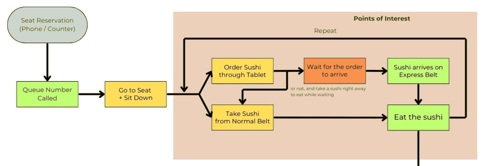
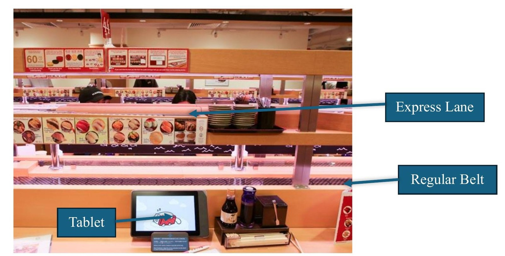
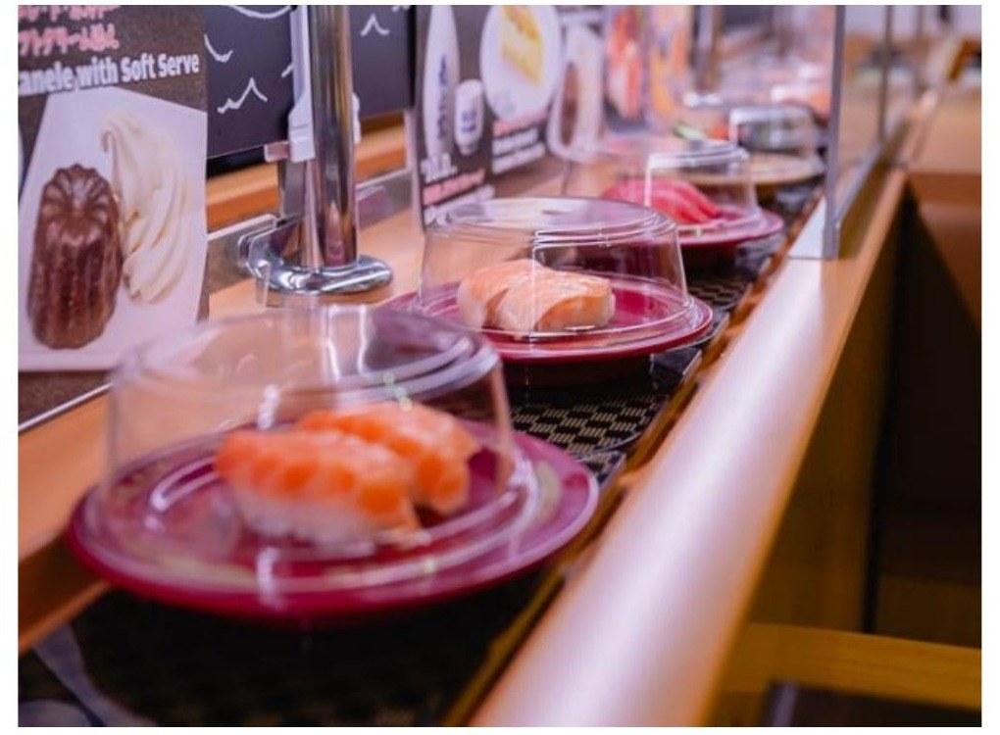
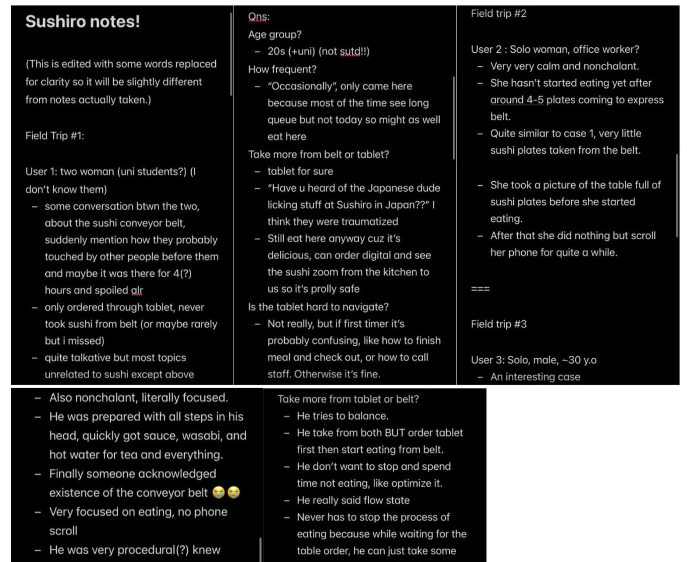

> This ethnography was conducted as part of the 02.005 Introduction to Human-Centered Design course at SUTD.

## Introduction

This paper studies the sushi conveyor belt and ordering system used in "Kaiten-sushi" restaurant chains, specifically Sushiro, observed from the point of view of the individual bar seating area. While this ordering system is used by a few other chains, this ethnography focuses solely on the implementation at Sushiro in Singapore. Observations were conducted at the Sushiro branch in Tampines 1 Mall, a busy location with a constant flow of diners across age groups, from students to working adults and the elderly.

In traditional restaurant settings, ordering food requires human interaction with a server, who manually notes down the order and delivers the food once it's ready. In "Kaiten-sushi" restaurants, however, portions of food are served on small plates on a rotating conveyor belt. This style of dining originated in Japan before spreading around the world through the popularization of sushi restaurant chains, a unique experience distinct from typical dining places. This ethnography sets out to uncover the hidden dynamics of "Kaiten-sushi" dining, what truly makes it different, and where there's room to improve the system.

I chose this topic because it's a sophisticated system used by a diverse group of customers, some already accustomed to it, others entirely new. Learning how people understand and adapt to this food-ordering system felt like a great opportunity.

## Methods

To fully understand how the conveyor belt system at Sushiro works within its social context, I observed as a participant myself, supplemented with semi-structured interviews as a guideline. I immersed myself in the environment by actively participating in the ritual (eating at the restaurant) to keep my observation as unobtrusive as possible. This let me blend in naturally like a typical customer, while also letting me interact directly with the ordering system from start to finish, in addition to observing how other people interact with it.

My process started with entering the bar seating, usually a row with a few other solo or pair diners. During peak hours, I was almost always seated next to an existing customer already eating. I'd observe them unobtrusively for around 15 minutes, focusing on how they used the digital tablet ordering system or the regular rotating conveyor belt, how they adapted to or understood the system, and other interactions with the technology.

I'd also spend a few minutes outside Sushiro and approach diners who came alone or in small groups as they were leaving, asking a few brief questions about their experience with the conveyor belt system, kept conversational, to learn more about how they felt about the ordering system.

Throughout the study, these were the ethical and moral considerations:

- Privacy remained the priority. I used the measures above to blend in as much as possible and avoid obstructing other diners while observing their interactions with the technology.
- All data collected is anonymous and used solely as reference material after the observation period.
- I adhered to the restaurant's code of conduct, especially the time limit during peak hours, to avoid overstaying and unnecessarily occupying a seat during crowded periods.

## Findings

From my own observation (and experience), a simplified user journey at Sushiro can be divided into three main phases. The main point of interest is the dining phase, where customers order or take sushi from the belt. The user journey involves a mix of digital interfaces, communal resources, physical technology, and shared spaces.

### Phase 1 — Queueing & Seating

The journey begins at the digital counter, where users input the number of people and receive a queue ticket. Once their number is called, they "check in" at the same counter to receive a seat number and guide themselves to the table. The initial 3–5 minutes are spent "setting up", preparing soy sauce dishes, dispensing hot water, and gathering wasabi or ginger from the conveyor belt. This phase involves some use of "communal resources" inside the restaurant.

### Phase 2 — Dining

The core of the dining experience, and the main point of interest. Customers have two ways to get food here.

Sushiro stands out even compared to other Kaiten-sushi chains. The conveyor belt is more sophisticated, with two layers, the "regular belt" and the "express lane." The regular belt constantly revolves with various plates of sushi diners can take straight away. The express lane only delivers made-to-order plates to the user's table, i.e. it only serves orders placed through the tablet, which arrive a few minutes later, transported directly from the kitchen.

*(See the appendix below for photos and an illustration of the seating area.)*

### Phase 3 — Checkout

Users initiate checkout via the tablet. The plates on the table are scanned and the total price is calculated. The user then takes a physical "payment card" to the front counter or an automated kiosk to pay.

## Descriptions of Observed Behaviors

### Case 1: Two University Students (roughly 20 years old)

A pair of diners in casual attire sat together at the bar seating. They chatted and actively inspected the lower belt but never retrieved a plate from it. During their conversation, one pointed at the sushi plates on the rotating belt and remarked on how "no one knows how long it's been sitting there, rotating around the entire restaurant." Instead of taking the readily available sushi, they almost exclusively ordered through the tablet and waited for it to arrive via the express lane.

Sitting adjacently, I asked them a few questions, and it came down to the fact that they were skeptical about the hygiene of the sushi on the lower belt and viewed it only as a physical menu showcase. They briefly mentioned an incident at a Sushiro branch in Japan, where a teenager licked a communal soy sauce bottle and placed it back [1], an event that made them view "Sushiro-kind" restaurants differently. The incident led Sushiro to revamp its communal belt concept in Japan, though it remained unchanged in overseas branches.

Still, they said it wasn't enough to deter them from returning, since the digital ordering system gave them confidence in hygiene standards. "We still eat here occasionally anyway 'cause it's too delicious," one of them said. Her reaction was casual, they weren't too concerned, since they could watch the freshly made sushi "zoom" through the express lane to their table, untouched by anyone but the chef who made it.

### Case 2: Solo Dining Office Worker (roughly 30 years old)

A solo diner in relatively formal attire sat at the bar seating and immediately began interacting with the tablet. Like the pair above, she completely ignored the lower belt. Her behavioral loop consisted of ordering via the tablet, waiting for a few items to arrive on the express lane, arranging them neatly on the table, and taking a photo before eating. She also kept checking the "Order History" tab after every order, seemingly keeping strict track of what she'd ordered, whether for financial or health reasons.

She took several packets of wasabi from the conveyor belt each time it passed, though not all were used, some were still on the table when she left.

### Case 3: Solo Dining Man (roughly 30 years old)

A man in casual attire, quite active with fast, deliberate movements in taking sushi plates from the belt and getting condiments. His routine was clear from the start, he got hot water, poured soy sauce into the small dish, and ordered through the tablet without hesitation. He ordered digitally as soon as he sat down, but still took plates from the regular belt, slowly eating them while waiting for his digital order to arrive on the express lane.

When asked how familiar he was with Kaiten-sushi restaurants, he said he's a frequent visitor who comes to this branch most weekends, and is familiar with the layout and ordering system. He described using both the digital system and the physical belt so he never has to spend time doing nothing, a loop that lets him reach a kind of "flow state" of continuous eating, without waiting idly for either system. When asked about hygiene concerns, he mentioned the technology Sushiro uses to detect plates that have been on the belt too long and lost freshness (more on this below, under Key Insights). He'd read about it out of curiosity as a frequent diner, and said he understood why some people might be wary of the belt's hygiene, though it wasn't something that bothered him personally.

## Key Insights

### Low Trust in the Physical Conveyor Belt

Sushi plates on the regular belt seem secondary in the dining experience, people trust the freshly made-to-order sushi from the digital system, sent via the express lane, far more. The conveyor belt functions more as an immersive 3D physical menu. The social practice of communal dining at Kaiten-sushi restaurants has been permanently altered by the viral incident, denting customer trust. Despite physical measures like plastic plate covers, the lower belt is still perceived by some as unsafe.

### The Importance of Order Tracking

For some users, knowing what they've eaten from the start matters. While they could technically count the plates stacked on their table, some would rather check the total directly from the tablet. This raised an important point: only sushi plates ordered digitally through the tablet are recorded in the tablet's "Order History" while eating. Plates taken directly from the rotating belt aren't recorded immediately, only accounted for and calculated at the very end, during checkout.

### Optimization in Dining

Some users intuitively try to "optimize" their dining experience to reduce waiting time. They might plan ahead, ordering a few plates digitally first, then grabbing other sushi from the regular belt while waiting, effectively eating other food while their "main" order is in transit. There seems to be a balance between spending money and eating sushi that many users are consciously trying to strike.

## Design Opportunities

### Unified Order Tracking System

**Problem:** The current tracking system only shows sushi plates ordered digitally, in the tablet's "Order History" page. This discourages users from taking sushi directly off the regular conveyor belt, which means the belt isn't fully utilized and acts more like a showcase. (Though this could also be intentional on Sushiro's part: the belt as a "physical menu," while everyone still has the choice to order digitally.)

**Solution:** Sushi plates taken straight from the belt are already automatically checked at the end by a detection system before payment. That detection system could be extended to visually record plates taken physically from the belt as well, creating a unified "Order History" page where all orders, digital or physical, show up right away.

This directly addresses users who like to strictly track what they've ordered, letting anyone eating from both systems see a consolidated "Total Spent" and "Total Consumed" without stopping to count plates. It would also help new users unfamiliar with the system, since all orders would be actively tracked with the running total shown.

### Better Messaging Around Sushi Freshness

**Problem:** Some users avoid sushi from the rotating belt and order everything digitally due to hygiene and freshness concerns (e.g. a plate could, in theory, be rotating for a whole day without anyone noticing).

**Solution:** Sushiro already tracks rotating plates via an embedded IC chip that measures how long each has been in rotation [2]. This helps the restaurant track popular dishes (so more can be made) and discard any plate that's been circulating too long. But there's little to no messaging about this to the consumer. The design opportunity here is to use signage and semiotics to communicate this system to diners, building trust in sushi taken physically from the belt. As the journey map illustrates, waiting time, especially for solo diners with no one to talk to, is the lowest point of satisfaction. Making diners more confident in the regular belt's sushi could mean less time spent waiting on digital orders.

## Appendix

_Figure 1. The user journey from start to end. Green denotes positive feeling, while yellow and orange denote less satisfactory feelings. Diagram by the author._

_Figure 2. The bar seating of Sushiro, showing the regular conveyor belt at the bottom and the express lane at the top. Photo by the author._

_Figure 3. Sushi on the regular belt, served in plastic covers. Photo by the author._

_Figure 4. Raw fieldnotes taken on mobile phone during the three field trips. Notes by the author._

## References

[1] Magramo, K., & Ogura, J. (2023, June 10). *Sushi chain sues high school student who licked soy sauce bottle for $480,000.* CNN. [edition.cnn.com/2023/06/09/asia/sushi-chain-sues-boy-licked-soy-sauce-bottle-intl-hnk](https://edition.cnn.com/2023/06/09/asia/sushi-chain-sues-boy-licked-soy-sauce-bottle-intl-hnk)

[2] *Sushiro: Always bring the best sushi for you, because they know you.* (n.d.). Digital Innovation and Transformation, Harvard Business School. [d3.harvard.edu/platform-digit/submission/sushiro-always-bring-the-best-sushi-for-you-because-they-know-you](https://d3.harvard.edu/platform-digit/submission/sushiro-always-bring-the-best-sushi-for-you-because-they-know-you/)
