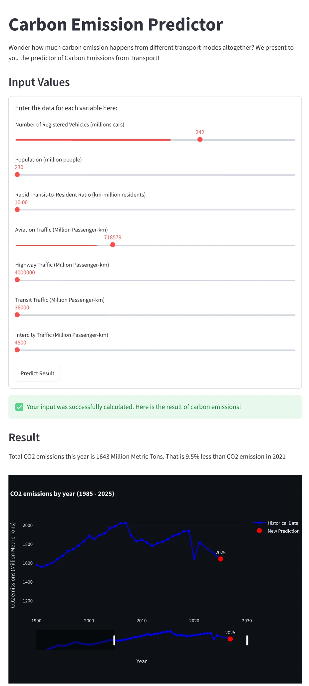

## Overview

This group project explores a transport policy design question: **how might we use historical traffic and population data to predict CO₂ emissions, and evaluate what happens if people shift between travel modes?**

The result is an interactive Streamlit web app where users adjust sliders for variables like aviation traffic or rapid transit ratio, and the model returns a CO₂ emissions prediction compared against a 2021 baseline — visualised alongside the full 1985–2025 historical trend.

See the full open-sourced work of our team [here](https://github.com/JustinTeh-Prog/DDW_ML).

## Architecture

| Component        | Technology                  | Purpose                                      |
| ---------------- | --------------------------- | -------------------------------------------- |
| Prediction Model | Python, NumPy, Scikit-Learn | Linear regression with feature normalisation |
| Data Pipeline    | Pandas                      | Ingestion, cleaning, and feature engineering |
| Web Interface    | Streamlit, Plotly           | Interactive slider-based prediction UI       |
| Testing          | Pytest                      | Model output validation                      |

## The Data Pipeline

The raw dataset covers 33 years of U.S. transportation records: multiple government sources with inconsistent formatting, encoding issues, and non-standard null markers. Before any modelling could begin, significant preprocessing was required.

The pipeline handled:

- **Encoding conflicts** — resolving CP1252 legacy file encoding and stripping formatting artefacts
- **Type coercion** — converting non-standard missing data markers and string-formatted numerals into clean float fields
- **Feature construction** — deriving the rapid transit-to-resident ratio from raw population and transit ridership figures
- **Log transformation** — applied to skewed features (registered vehicles, population) before normalisation

## The Prediction Model

The model predicts total transport-sector CO₂ emissions from seven input features:

| Feature                         | Description                            |
| ------------------------------- | -------------------------------------- |
| Registered Vehicles             | Total registered vehicles (millions)   |
| Population                      | U.S. population (millions)             |
| Rapid Transit-to-Resident Ratio | Transit capacity relative to residents |
| Aviation Traffic                | Aviation passenger-miles               |
| Highway Traffic                 | Highway passenger-miles                |
| Transit Traffic                 | Public transit passenger-miles         |
| Intercity Traffic               | Intercity rail and bus passenger-miles |

At prediction time, inputs are log-transformed, normalised using stored training statistics, and passed through a trained linear regression equation. The output is compared against the 2021 CO₂ baseline and plotted as a new point on the historical trend line.

_The interactive prediction interface with sliders to adjust each transport variable, and the model returns a predicted emissions figure with historical context._

## What-If Scenario Modelling

The practical value of the app is in scenario testing. By adjusting the rapid transit ratio upward while reducing highway traffic, users can observe modelled emissions reductions, giving transport planners a simple tool to quantify mode-shift strategies.

## Key Findings

Running the model against historical data revealed high multicollinearity between several traffic variables — aviation, highway, and transit passenger-miles move together across decades. This constrained direct feature attribution but confirmed that the rapid transit-to-resident ratio was among the stronger independent predictors of emissions reduction scenarios.

The model is intentionally transparent: it makes assumptions explicit, validates output against known baselines, and is framed as an educational planning tool rather than a production forecast.

## Links

- [GitHub Repository](https://github.com/JustinTeh-Prog/DDW_ML)
